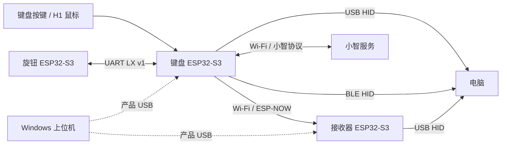

# 源码架构

[返回首页](../README.md)

## 键盘

入口为 `keyboard/main/main.c`。板级初始化/按键扫描在 `board.c`，USB Host 鼠标在 `usb_host_base.c`，蓝牙在 `ble_keys.c`，旋钮 UART 在 `knob_link.c`，灯光与音频偏好在 `user_controls.c`。

语音模块包括音频采集、Opus、唤醒、小智连接与官方激活、播放缓冲和语音输入。播放链路使用预缓冲及断流后的重新缓冲；音频处理的关键热数据与任务栈有不同内存要求，不要把所有内存一律挪到 PSRAM。模式保存涉及 NVS，需要符合 Flash/cache 操作限制的任务栈。

电量、休眠、低电灯效分别由 `battery_*`、`power_policy.c` 等处理。模式切换、按键映射、灯光与绑定配置保存于 NVS。

## 工程内组件

| 目录 | 职责 |
| --- | --- |
| `keyboard/components/bringup_usb` | 产品 USB HID / CDC、报文收发 |
| `keyboard/components/input_core` | 按键状态、自动文字、媒体键等输入处理 |
| `keyboard/components/hid_mouse` | HID 鼠标解析与队列 |
| `keyboard/components/radio_keys` | ESP-NOW 输入及状态维护 |
| `keyboard/components/network_link` | Wi-Fi、发现、认证、配置事务、控制回传 |
| `keyboard/components/protocol` | LX v2 帧编解码、CRC、流解析 |

键盘和接收器各自包含这些组件的完整副本，维护时由检查脚本核对一致性。接收器接收无线输入并提交到 USB HID，另有独立状态灯任务。设置和绑定由各自设备保存，不使用仓库内写死的私人参数。

## 旋钮

入口为 `knob/main/app_main.c`；`components/app` 协调子系统，`event` 提供事件总线。`haptics` 管理 SimpleFOC 和触觉，`input_strain` 管理 HX711 与校准，`ui` 使用 LVGL 8.3.11，`host_link` 与键盘通信，`ble_dial` 提供独立 Dial 功能。

校准兼容版本由 `project_build_id` 固定，不随编译时间变化。界面图片已经转换为可编译的 C 数组，正常构建不依赖原始设计工程。

## 依赖原则

每块板的组件和协议均在自己的目录内。联网依赖由 `idf_component.yml` 固定版本、`dependencies.lock` 锁定包摘要；键盘的 WebSocket 快照保留在自己的 components 中。库升级、分区变更、硬件换型和协议变更应分开验证；不得为了通过本地构建改回某个开发者的绝对路径。
